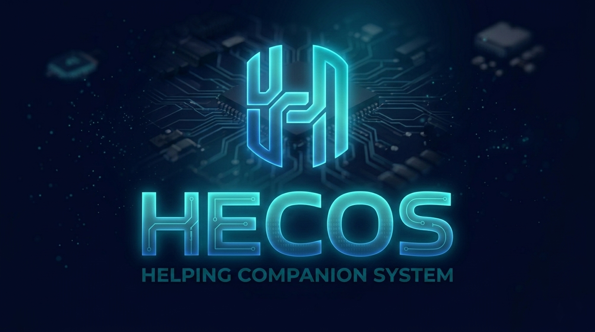
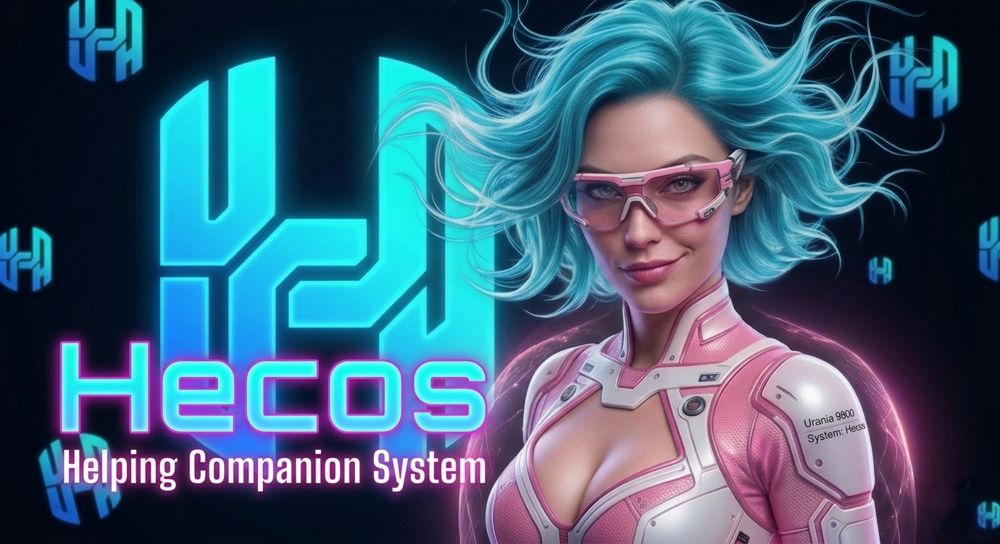

# 🌌 Hecos Project
<p align="center">
  
</p>

# Hecos - Version 0.55.2 (Phase II: Ghost Fire)
Language: [English](README.md) | [Italiano](README_ITA.md) | [Español](README_ESP.md)

# 🤖 Hecos
**Helping Companion System (Private, Fast, Simple)**

<p align="center">
  <a href="https://github.com/Hecos-Project/Hecos/releases/latest/download/INSTALL_HECOS_WINDOWS.zip">
    
  </a>
  &nbsp;
  <a href="https://github.com/Hecos-Project/Hecos/releases/latest/download/INSTALL_HECOS_LINUX.zip">
    
  </a>
  &nbsp;
  <a href="https://github.com/Hecos-Project/Hecos/wiki/00_introduction_en">
    
  </a>
</p>

---

> ### ⚡ Core Motto
> **"Zero moral filters. Zero social bias. Zero political agendas. From the core engine to every single module, Hecos is built on one unshakeable rule: freedom of thought belongs to everyone."**

---

> **Status: Phase II (Ghost Fire)**: Hecos is currently in `v0.55.2`. This is a Helping Companion System acting as a bridge between high-level reasoning and root system execution.
>
> ⚠️ **Important Notice**: Starting from this major release (0.50.0+), the primary development and target environment is officially **Windows 11**.

## 🚀 Overview
**Hecos** is a **Helping Companion System**: a private, local-first ecosystem designed to seamlessly bridge technology and human life by combining AI reasoning, visual automation, and direct system execution. Rather than chasing abstract concepts like digital sovereignty, Hecos focuses on a single, pragmatic mission: **improving human life** by turning local hardware into a highly efficient, practical everyday tool.

Built on our core pillars:
* 🕊️ **Freedom of Thought** — Zero moral filters, zero social bias, zero political agendas.
* 🛡️ **Privacy First** — 100% local operation, zero cloud dependency, and a 3-tier privacy architecture.
* ⚡ **Extreme Speed** — Optimized native architecture and high-performance plugin system for real-time responsiveness.
* 🧊 **Total Simplicity** — Professional dashboard and a modular design that makes advanced orchestration intuitive.

Now fully migrated to a **Phase II: Ghost Fire stable architecture**, Hecos 0.55.2 brings a dedicated Web Interface (Chat + Config), a **Unified 5-Step Graphical Installer** (Core + Tray, zero Python prerequisites), and full internationalization. Powered by **LiteLLM**, it supports Ollama, Llama.cpp, KoboldCpp, and major cloud providers with real-time streaming and local TTS (Kokoro, Piper, Fish Speech, and XTTS).

---

## ✨ Key Features (v0.55.2)
* 🚀 **Unified Graphical Installer & Resilient Setup** — Official 5-step desktop Setup Wizard (`INSTALL_HECOS_WINDOWS.bat` / `INSTALL_HECOS_LINUX.sh`) that auto-provisions an isolated Portable Python 3.11 runtime (SHA256-verified, with `tkinter`), installs tested versions from `constraints.txt`, supports custom folders via shared `install.toml`, and includes built-in **System Diagnostics (`Doctor`)** and **Quick Repair**.
* 🎙️ **Voice Forge Studio** — Advanced vocal synthesis and sculpting studio featuring real-time acoustic analysis (Formants, Radar vocal profile, Spectrogram) and multi-preset voice blending.
* 🐟 **Fish Speech SOTA Zero-Shot TTS** — Cutting-edge neural speech synthesis with instant voice cloning running locally via dedicated daemon and server.
* 🧬 **Kokoro Voice Cloning & Voice Manager** — Custom voice cloning integration for Kokoro TTS with a dedicated clone manager UI and live inference preview.
* 🎛️ **Modular Audio Architecture** — Redesigned card-based audio control room (Fish Speech, Kokoro, Piper, XTTS, dynamic audio routing, hardware mic) with high-performance unified TTS caching.
* 📑 **Config Hub Pagination & Deep Search** — Centralized module browser with customizable per-category and global pagination, live deep search, and category new-item highlights with automatic 3-day TTL expiration.
* 📊 **Unified Task Progress Engine** — Standardized asynchronous progress tracking framework (`hecos.core.progress`) for downloads, pip installations, and background routines across CLI and WebUI.
* 📦 **HPM SemVer Engine & Visual Badges** — Strict semantic versioning comparison eliminating downgrade warnings, enriched with visual badges displaying installed vs. store version on cards and modals.
* 📡 **Presenter & Playbook (Training, Coach, Roleplay)** — Interactive engine natively built into the Core for system announcements, active notifications, and real-time voice narration (with dedicated toolbar Show/Hide, collapse, and context ON/OFF controls). Combined with the packaged **Playbook** module, Hecos transforms into a versatile interactive training and simulation platform.
* 🎚️ **Preset Manager & Global Presets (`F3`)** — Unified searchable preset drawer with total counter, creation date and usage statistics, instant live drafts, **Enable Thinking** toggle, and **Granular Tool Selection** (with real-time token-budget estimation) to assemble and switch complete AI, Persona, Voice, and Payload snapshots.
* 📋 **Multimodal Action Plans** — Domain-agnostic **Architect First (`Plan First` / `/plan`) & Execution Recovery** engine for **software engineering** (`Hecos Coder`), **sequential photo shoots & storyboards** (`Hecos Storyboard & Photo Director` + `IMAGE_GEN`), **travel itineraries, research, and workflows** (`Hecos Action Planner` + `NETSEARCH`). Features interactive Blueprint versioning (`v1`, `v2`…), **`Execute Plan`** / **`Next Step`** / manual check-off, **`Run with Preset`** selector, **`AgentResume`** checkpoints, Presenter-style resize, draggable Float & multi-monitor **Pop-out** viewer, auto-save Markdown mirroring in `hecos/media/action_plans/`, and native OS Export/Import (`.md`, printable lossless `.html`, `.yaml`, `.json`).
* 💻 **Hecos Coder & Workspace Runner (Modular `system_app`)** — Optional software development package (`coder`) with interactive **Workspace Runner**, embedded **Monaco Workspace Explorer**, isolated **Aider Sidecar**, Tree-Sitter AST Repo Map, non-destructive Git checkpoints, OS process watchdog, and native Windows CLI terminals (hidden automatically for non-developers when disabled).
* 📦 **HPM 0.40 Architecture** — Fully migrated to Pydantic+TOML configurations, introducing dependency version constraints and locked `pip_requirements`.
* 🛠️ **External Dependency Manager (EDM)** — New system that auto-detects missing core dependencies (Node, Tesseract, VC++), enabling one-click downloads directly from the WebUI.
* 🛡️ **HPM Integrity Verification** — New `/verify` API and Control Room UI to cryptographically validate installed package files against their Ed25519-signed manifest hashes.
* 🔒 **Hecos SDK (Total Isolation)** — Run HPM packages in dedicated, isolated subprocesses and independent virtual environments (venv) to prevent dependency hell and main event loop blocking.
* ⚡ **HDCS (Direct Commands)** — Instantly execute 150+ native functions bypassing the AI brain via `/` in chat or `Ctrl+Alt+Space` globally.
* ⚙️ **Flows Automation Engine** — Visual drag-and-drop node editor for creating complex, multi-step triggers and actions, fully integrated with NLP voice commands.
* **📅 Integrated Calendar** — Full calendar module with holiday tracking and localized event color coding.
* **⏰ Reminder Module** — NLP-powered task scheduler with snooze capabilities and active OS notifications.
* **💻 Action Window** — Clean, terminal-style console directly inside the chat UI for monitoring native system execution and background processes.
* **🎵 New Media Player** — Advanced audio backend (VLC 64-bit + FFplay fallback) supporting resilient resume/pause state, dynamic playlist calculations, and global volume control.
* 🎨 **Flux Prompt Studio** — Real-time prompt engineering for Flux.1 with automatic sidecar metadata persistence.
* 🖼️ **Image Metadata Injection** — Generative AI results now include hidden JSON sidecars (.txt) containing prompt, seed, and sampler info for professional workflows.
* 🎭 **Enhanced Chat UI** — New Chat headers with visible User/Persona names, timestamps, and improved message action positioning (Copy/Edit/Regenerate).
* 🔄 **Fixed Regeneration** — Resolved critical history duplication and session-mismatch issues during message regeneration.
* 🗃️ **Dual-Mode Chat Archive** — Context-aware archiving system with individual chat restore and bulk-delete capabilities.
* 🧠 **High-Performance RAG (FastEmbed)** — CPU-native, multi-tenant vector memory utilizing ONNX and LanceDB for blazing-fast document ingestion.
* 🔐 **Per-User Vault Isolation** — Consolidated memory architecture ensuring absolute privacy separation for semantic data and chat history per profile.
* 🛡️ **3-Tier Privacy Architecture** — Unified session management with **Normal**, **Auto-Wipe** (RAM-only store, cleared on exit), and **Incognito** (Zero-trace) modes.
* 📦 **Hecos Module Manager (HPM)** — The unified control center for universal extensibility, organizing **Package Library**, **Core System**, **Widget Layout**, and **Store** in one place. Easily install third-party plugins, System Apps, widgets, personas, and config panels via drag-and-drop signed `.hpkg` bundles with isolated configurations and Ed25519 digital signatures.
* 🔌 **Universal Tool Hub (MCP Bridge)** — Native support for the **Model Context Protocol**. Connect to thousands of external AI tools with a single click.
* 🔭 **Deep MCP Discovery** — Advanced explorer with multi-registry search (Smithery, MCPSkills, GitHub) and one-click installation.
* 🔒 **Professional Hecos PKI (HTTPS)** — Self-signing Root CA for a full "Green Lock" experience on all devices.
* 🏗️ **Native WebUI Plugin** — High-performance, low-latency interface for desktop and mobile.
* 🎛️ **Control Room & Widgets** — A customizable, masonry-style dashboard for real-time widgets and OS telemetry.
* 🌐 **Browser Automation** — Native plugin for semantic web interaction and scraping.
* ⌨️ **OS Automation** — Native plugin for programmatic mouse and keyboard control.
* 💾 **Hecos Drive (File Manager)** — Integrated dual-panel file management and editor.

---

## 🧠 How It Works
Hecos is built around a highly modular, 8-layer architecture. Everything is a **module**:
* **Core Modules** → Built-in, non-removable OS/system functions
* **Plugins** → Reactive tools and capabilities called by the AI (system, web, media, etc.)
* **Apps** → Autonomous mini-applications with their own standalone UI and lifecycle
* **Personas** → Installable AI personalities and behavioral profiles
* **Widgets** → Interactive frontend components for the Control Room dashboard
* **Themes** → Custom CSS and styling packages for the UI
* **Skill Packs** → Additional slash-command packs for the chat interface
* **MCP Servers** → Universal external tool bridges via the Model Context Protocol

The AI generates structured commands that are interpreted and executed through the plugin system.

---

### 🎭 The Soul of the Machine: Native Personas

A fundamental capability of Hecos is its native **Personality Switching**. Hecos isn't just a cold, rigid assistant — it adapts its behavior, tone, and character based on the persona you load. Each persona is programmed to act differently and fulfill a unique role in your daily life.

<p align="center">
  
  <br>
  <em>Urania 9800, the official Hecos Mascot and your everyday friendly companion.</em>
</p>

Out of the box, Hecos includes several pre-configured personalities:
* **Hecos System Soul** — The neutral, rigid, and detached core system. Perfect for raw automation and precise tasks.
* **Urania 9800** — The lively mascot. A true, everyday friend designed for casual, empathetic, and cheerful interaction.
* **Sebastian Pro** — The perfect, highly professional butler. Polite, efficient, and eager to serve.
* **Atlas** — The imposing, authoritative digital guardian.
* **Nova X-01** — A precise, analytical robotic entity for those who prefer purely logical interactions.

You can hot-swap these personas at any time, changing not just the voice and tone, but the very "soul" of the system.

---

### 📢 Presenter & Playbooks: Training, Coaching & Roleplay

The **Presenter** is an interactive engine natively integrated into the Hecos Core for system announcements, active notifications, and real-time live commentary with voice narration.

Combined with the packaged **Playbook** module, Hecos evolves beyond a traditional assistant into a complete interactive learning, simulation, and training environment:
* 🎓 **Interactive Training & Coaching System** — Provides step-by-step guidance through operating procedures, complex technical tasks, or structured personal study.
* 🗣️ **Language Learning** — Practice conversational skills in foreign languages with live feedback, grammatical insights, and guided pronunciation.
* 🎭 **Dynamic Roleplay & Scenarios** — Simulate job interviews, business negotiations, or rich narrative storylines powered by AI characters with structured directives and trigger conditions.

---

### 📋 Multimodal Action Plans: Code, Storyboards & Workflows

The **Multimodal Action Plans** subsystem bridges **structured planning** and **step-by-step autonomous execution** across any creative, technical, or operational task:
* 📐 **Architect Mode (`Plan First` / `/plan`):** Draft and interactively revise rich Markdown Blueprints (`title`, `goal`, technical specs or shot Continuity Bibles, and numbered steps) *before* touching workspace files or generating images.
* 🎯 **Domain-Agnostic + Dedicated Presets:** Pair any plan with specialized **Global Presets** via **`Run with Preset`** — `Hecos Coder` for apps, `Hecos Storyboard & Photo Director` for multi-shot `IMAGE_GEN` sequences, or `Hecos Action Planner` for travel, research, and real-world checklists.
* ⏭️ **Granular Control & Continuity:** Execute everything end-to-end (**`Execute Plan`**), generate/run one frame or milestone at a time (**`Next Step`**), or manually check off steps — backed by live **`AgentResume`** crash/timeout recovery.
* 🪟 **Detachable Workspace & Auto-Save:** Resize using Presenter-style row controls, float anywhere on screen, open a live-synced multi-monitor **Pop-out** (`/action-plan-viewer`), find every plan auto-saved in `hecos/media/action_plans/`, and export/import natively as **Markdown (`.md`)**, standalone printable **`.html`**, **`.yaml`**, or **`.json`**.

---

## ⚡ Quick Start (Official Unified Installation)

### 1. Recommended — Official Graphical Installer (1-Click, No Python Needed)

<p align="center">
  <a href="https://github.com/Hecos-Project/Hecos/releases/latest/download/INSTALL_HECOS_WINDOWS.zip">
    
  </a>
  &nbsp;
  <a href="https://github.com/Hecos-Project/Hecos/releases/latest/download/INSTALL_HECOS_LINUX.zip">
    
  </a>
</p>

You do **not** need Python installed beforehand. Download the ZIP archive for your OS, extract it, and run the installer:

* **Windows:** double-click **`INSTALL_HECOS_WINDOWS.bat`** *(if Windows SmartScreen shows a notice, click **More info → Run anyway**)*.
* **Linux / macOS:** run **`bash INSTALL_HECOS_LINUX.sh`** — or directly from terminal:
  ```bash
  curl -fsSL https://raw.githubusercontent.com/Hecos-Project/Hecos/main/INSTALL_HECOS_LINUX.sh | bash
  ```

The **5-step graphical wizard** lets you choose **Hecos Complete (Core + Tray — Recommended)**, **Core Only**, or **Tray Only**, pick **any drive or folder** (avoiding spaces/accents/special characters), monitor live progress, run automatic **Doctor** verification, and launch Hecos immediately.

### 2. Developers / Manual Clone
```bash
git clone https://github.com/Hecos-Project/Hecos.git
cd Hecos
```
Then run **`INSTALL_HECOS_WINDOWS.bat`** / **`bash INSTALL_HECOS_LINUX.sh`** (for the graphical wizard) or **`scripts\windows\setup\HECOS_SETUP_WIZARD.bat`** / **`bash scripts/linux/setup/HECOS_SETUP_WIZARD.sh`** (for the CLI wizard, `--unattended`, or `--doctor`).

### 3. Launchers, CLI Setup & Utility Scripts

| Platform | Script | Description |
| :--- | :--- | :--- |
| **Windows** | `INSTALL_HECOS_WINDOWS.bat` | **Official Unified Graphical Installer** (Core + Tray, 5-step window) |
| **Linux / macOS** | `INSTALL_HECOS_LINUX.sh` | **Official Unified Graphical Installer** (supports `--cli`, `--unattended`, headless fallback) |
| **Windows** | `HECOS GLOBAL LAUNCHER.bat` | Terminal menu: Setup, WebUI, Console, Coding Studio CLI & **Doctor** |
| **Linux / macOS** | `HECOS GLOBAL LAUNCHER.sh` | Terminal menu: Setup, WebUI, Console & **Doctor** |
| **Windows** | `scripts\windows\setup\HECOS_SETUP_WIZARD.bat` | CLI Setup & Repair (`--unattended`, `--doctor`, `--gui`) |
| **Linux / macOS** | `scripts/linux/setup/HECOS_SETUP_WIZARD.sh` | CLI Setup & Repair (`--unattended`, `--doctor`, `--gui`) |
| **Windows** | `HECOS_WEBUI_RUN_WIN.bat` | Launches ONLY the Web Interface & Watchdog |
| **Linux / macOS** | `HECOS_WEBUI_RUN_LINUX.sh` | Launches ONLY the Web Interface & Watchdog |
| **Windows** | `scripts\windows\run\HECOS_CONSOLE_RUN_WIN.bat` | Launches ONLY the Terminal Console |
| **Linux / macOS** | `scripts/linux/run/HECOS_CONSOLE_RUN.sh` | Launches ONLY the Terminal Console |
| **Tray Repo** | `START_HECOS_TRAY_WIN.bat` / `START_HECOS_TRAY_LINUX.sh` | Launches Hecos Tray & Dashboard (detached) |

### 4. Configuration & First Run
Hecos is designed for a professional "download-and-play" experience.
- On your first run, the system will detect that `system.yaml` and `routing_overrides.yaml` are missing.
- It will **automatically generate** these files by copying the templates from `hecos/config/data/*.example`.
- You can find your personal configuration in `hecos/config/data/system.yaml` (main settings) and `routing_overrides.yaml` (AI routing rules).
- **Pro Tip**: Use the built-in [In-WebUI Routing Editor] to safely modify these rules without touching code.

### 🔐 Login & Authentication
Hecos requires mandatory Auth. The default first-time login is:
- **Username:** `admin`
- **Password:** `hecos`

We strongly recommend changing the password immediately from the **Users Tab** inside the Configuration Panel.

**Password Recovery:**
If you get locked out, run `python scripts/reset_admin.py` from the terminal to force a new password, or manually delete the `memory/users.db` file to reset the system defaults.

### 🛡️ Stealth Mode (Windowless)
If you want Hecos to run completely in the background without any visible terminal windows:
1. **Use the Tray Icon**: Start Hecos using the system tray icon. It will manage the system components invisibly in the background.
2. **Silent Boot**: Use `START_HECOS_SILENT_WIN.vbs` for a 100% invisible start (no console windows).
3. **Manual Recovery**: If you close the icon by mistake, use `START_HECOS_TRAY_WIN.bat`.

---

## 💻 Platform Compatibility & OS Support

While many extension packages in the Hecos ecosystem (such as **Browser Automation**, **Messenger**, **Calendar**, **Weather Pro**, **Mail**, **Image Gen**, **Reminder**, **Lists**, **Maps**, and **Quick Links**) are completely cross-platform and designed to run on Linux and macOS, **the core Hecos system itself is currently tested exclusively on Windows 10 and 11**.

Running the core system on Linux or macOS is possible but may require manual adjustments, and certain native OS features (like advanced PC Automation UI inspection) are Windows-only by design.

---

## 🛠️ Essential System Requirements (Windows)
If you have just reinstalled Windows or are setting up Hecos for the first time, you must ensure these **fundamental** system packages are present for all modules to work correctly.

💡 **NEW (v0.45.0 - EDM)**: Hecos now integrates an **External Dependency Manager (EDM)**! If Tesseract, Node.js, or VC++ Redistributable are missing, the EDM will automatically detect them and allow you to download them in the background with a single click from the WebUI, directly from the `Hecos-Dependencies` GitHub repository. Alternatively, you can install them manually:

1. ⚙️ **Microsoft Visual C++ Redistributable (Mandatory)**
   - *What it's for*: Required by the RAG Memory engine (ONNX/FastEmbed). Without this package, you will get missing DLL errors and document search will not work.
   - *Download*: 👉 [Download VC++ Redist x64](https://aka.ms/vs/17/release/vc_redist.x64.exe)

2. 🎵 **VLC Media Player 64-bit (Mandatory)**
   - *What it's for*: The Audio engine and integrated Media Player of Hecos use VLC libraries in the background to play music, alarms, and TTS voice output.
   - *Download*: 👉 [Download VLC 64-bit](https://www.videolan.org/vlc/download-windows.html)

3. 👁️ **Tesseract OCR (Recommended for Vision)**
   - *What it's for*: Necessary for advanced visual capabilities and to read text on the screen via OCR (`pytesseract`). 
   - *Download*: 👉 [Download Tesseract OCR for Windows](https://github.com/UB-Mannheim/tesseract/wiki)

4. 🟢 **Node.js (Recommended / Required for Canvas & UI Development)**
   - *What it's for*: Required to compile, build, and manage dependencies for the Flows Visual Node Editor module (ReactFlow/Vite). If you need to rebuild the canvas frontend (`npm run build`), Node.js is required.
   - *Download*: 👉 [Download Node.js LTS](https://nodejs.org/)

---

### 📦 Offline Installation (The `dependencies` Folder)
For your convenience, all required installation packages are included offline directly inside the `dependencies/` folder at the root of the project:
* `dependencies/VC_redist.x64.exe` -> Microsoft Visual C++ Redistributable (ONNX/RAG)
* `dependencies/node-v24.16.0-x64.msi` -> Node.js LTS (Canvas / Frontend Build)
* `dependencies/tesseract-ocr-w64-setup-5.5.0.20241111.exe` -> Tesseract OCR (Vision)

*Note: We highly recommend installing these components before launching the automatic Hecos setup.*

---

## 🧠 Supported AI Backends (LLM Engines)

Hecos is completely offline by default and requires a local AI engine to process logic and conversation. During setup, you must install one of the independent backends below. Hecos will automatically detect them.

### 🔹 1. Ollama (Recommended)
Fast, optimized, and easy to run locally as a background service.
- **Download**: 👉 https://ollama.com/download
- **Setup**: Once installed, open your terminal/command prompt and run `ollama run llama3.2` to download and test a lightweight fast model. Hecos will instantly detect it.

### 🔹 2. Llama.cpp (Alternative)
The gold standard for running raw local models with maximum efficiency and customization.
- **Setup**: Launch your `llama.cpp` server on its default port. Hecos is fully compatible and will route requests via its internal proxy.

### 🔹 3. KoboldCpp (Alternative)
Perfect for GGUF manual models and older hardware without heavy installation.
- **Download**: 👉 https://github.com/LostRuins/koboldcpp/releases
- **Setup**: Download the `.exe` (or Linux binary), double-click it, select any GGUF instruction model downloaded from HuggingFace, and launch. Hecos will connect via port `5001`.

---

## 🔌 Plugin System
Hecos uses a dynamic plugin architecture. Each plugin can register commands, execute system actions, and extend AI capabilities.

Included plugins:
* **System control & File manager**
* **Web automation & Hardware dashboard**
* **Media control & Model switching**
* **Memory management**

You can install new packages dynamically by dragging and dropping `.hpkg` bundles into the **Module Manager** inside the WebUI. These standalone bundles contain their own logic, UI panels, and configuration schemas, making Hecos infinitely and universally extensible. All packages are verified via Ed25519 digital signatures for absolute security.

---

## 💾 Memory & Voice Systems

### 🗄️ Memory System
Hecos includes a persistent memory layer powered by SQLite for lightweight local storage. It stores conversations, maintains identity, and saves user preferences.

### 🎙️ Voice System
* **Speech-to-text input**
* **Advanced Text-to-Speech output** (Featuring both Kokoro TTS and Piper TTS for natural, high-fidelity local voice generation)
* **Real-time interaction**

---

## 🔗 Integrations & Privacy

### 🤝 Integrations
Hecos can integrate with:
* **Open WebUI** (chat + streaming)
* **Home Assistant** (via bridge)

### 🔐 Privacy First
Hecos is designed with a strict focus on utility and discretion: Runs 100% locally, features no mandatory cloud services, and provides full control over data.

---

## 🛣️ Roadmap
- [ ] 📱 Telegram integration (remote control)
- [ ] 🧠 Advanced memory system
- [ ] 🤖 Multi-agent architecture
- [ ] 🛒 Plugin marketplace
- [ ] 🎨 Improved UI/UX

---

## ⚠️ Disclaimer
Hecos can execute system-level commands and control your environment. Use responsibly. The author is not responsible for misuse or damage.

---

## 📜 License
GPL-3.0 License

---

## 👥 Credits & Contact
Lead Developer: Antonio Meloni (Tony)
Official Email: hecos.project@gmail.com

---

## 📚 Documentation
Hecos uses a modular documentation system localized in EN, IT, and ES.

### Local Access (Modular)
Detailed guides are located in the `docs/` folder:
- 📖 **[Unified Guide](docs/UNIFIED_GUIDE_EN.md)**: Everything you need to know about v0.44.0.
- 🏗️ **[Technical Guide](docs/tech/)**: (Admin/Dev) System architecture and OOP details.

### Online Access
The documentation is also synchronized with the **[GitHub Wiki](https://github.com/Hecos-Project/Hecos/wiki)**.

---

## 💡 Vision
Hecos aims to become a fully autonomous, local AI assistant platform — a private, extensible alternative to cloud-based AI systems, focused exclusively on serving and improving human life.